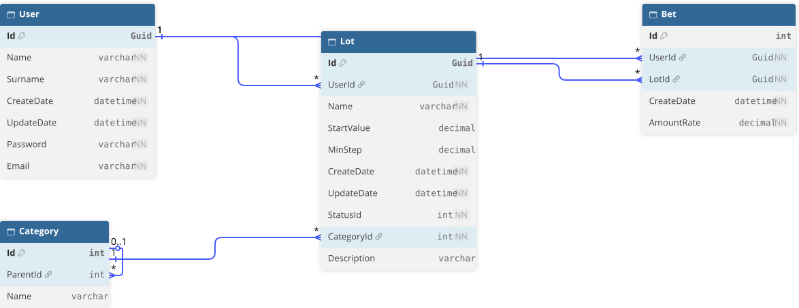

# OtusWebAuction
Учебный проект для Otus

## Авторы:
- Бордюг Александр (@Xandarel)
- Тулендинов Данияр (@danimsu)
- Ильдар (@dev-itsec)

## Структура
- OtusWebAuction - REST API бэкенд аукциона.
- OtusWebAuction.BL - Слой бизнесс логики.
- OtusWebAuction.DB - Слой работы с базой данных (PostgreSQL)
- OtusWebAuction.Domain - Слой для общих сущностей

## БД
Для локальной разработки можно завести базу данных в docker командой
docker run -d --name postgres-sql --restart unless-stopped -e POSTGRES_USER={userName} -e POSTGRES_PASSWORD='{pass}' -e POSTGRES_DB=sql -p 5432:5432 -v postgres_sql_data:/var/lib/postgresql postgres:18

userName и pass прописать в секрете OtusWebAuction в секции Postgres

## Схема БД

## Диаграмма приложения
